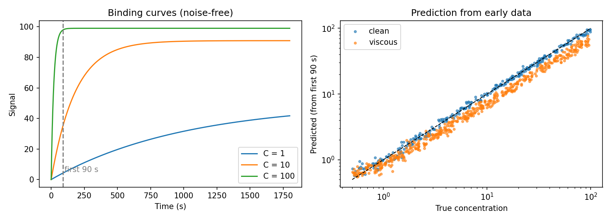

# Early-kinetics prediction of CRP concentration (simulation pilot)

**Question:** can the concentration of an analyte (here CRP) be predicted from only the
first 90 seconds of a biosensor signal, instead of waiting ~30 minutes for equilibrium?

**Status:** exploratory simulation / proof of concept. This is *not* validated on real sensors.

## What the code does
1. Simulates 1:1 binding curves, S(t) = S_eq (1 - exp(-k_obs t)), with k_obs = k_on[C] + k_off.
2. Adds sensor noise, baseline drift and small sample-to-sample variation in k_on.
3. Extracts features from the first 90 s: initial slope, curvature, baseline drift.
4. Trains a random forest to predict log10(concentration).
5. Tests on (a) clean held-out curves and (b) "viscous" samples where binding is 20-40% slower
   (never seen in training).

## Results (my run)
| Condition | Mean error | Median error |
|---|---|---|
| Clean, first 90 s | 6.9% | 4.8% |
| Viscous samples | 24.0% | 24.5% |

Error vs time window (clean): 30 s -> 10.3%, 60 s -> 6.8%, 90 s -> 6.6%

## Main finding
Early features predict concentration well under clean conditions, but accuracy drops when
sample viscosity changes, because the model reads slower binding as lower concentration.
This matrix-effect problem is exactly what I want to study.

## Limitations
- Simulated data only; real sensors have effects not modelled here (fouling, mass-transport
  limits,
